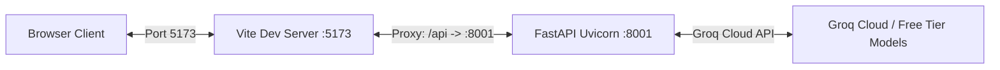

# FULL_APPLICATION_AUDIT.md — Complete Application Audit & Verification Map

**Audit Date:** November 2026  
**Auditor:** Senior Engineering & AI Product Development Team  
**Scope:** Complete Codebase (Frontend, Backend, AI Integrations, Testing Suite, Architecture)  
**Status:** PHASE 0 DISCOVERY COMPLETED — PENDING APPROVAL

---

## 1. Executive Summary & Verification Map

The AI Interview Coach 1.0 repository was thoroughly inspected without modifying any application source code. The application implements an in-memory, zero-database architecture designed to provide mock interview preparation.

### 1.1 Core Boundaries Verified
- **No Database:** In-memory dictionary state (`ACTIVE_SESSIONS` in `interview.py`). No persistent database, SQLAlchemy engine, or disk persistence.
- **No User Accounts:** No login, registration, user tables, or auth tokens.
- **No Permanent File Storage:** Resumes processed in memory via byte streams (`parse_resume_bytes`); temporary byte buffers released immediately.
- **Privacy First:** Web camera analysis (MediaPipe FaceDetector) runs completely client-side in browser WebGL; video frames are never transmitted to backend.
- **AI Integrations:** Groq Cloud SDK with free-tier model rotation (`qwen/qwen3.8-27b`, `allam-2-7b`, `openai/gpt-oss-20b`, `openai/gpt-oss-120b`).

---

## 2. Verified Technology Stack & Dependency Audit

| Layer | Declared in Doc | Actual Verified Runtime | Health / Status |
| :--- | :--- | :--- | :--- |
| **Python Runtime** | Python 3.11+ | Python 3.11.9 (`runtime.txt`: `python-3.11.9`) | Verified & Operational |
| **Node.js Runtime** | Node 18+ | Node.js v24.15.0, npm 11.12.1 | Verified & Operational |
| **Backend Framework**| FastAPI >=0.115.0 | FastAPI 0.136.1, Uvicorn 0.46.0 | Operational |
| **Data Validation** | Pydantic >=2.8.0 | Pydantic 2.13.4, Pydantic-Core 2.46.4 | Operational |
| **Frontend Framework**| React 18 / 19 | React 19.0.0, React-DOM 19.0.0 | Operational (React 19) |
| **Frontend Build** | Vite >=6.1.0 | Vite 6.4.6 (`@vitejs/plugin-react` 4.3.4) | Build passes cleanly |
| **Styling** | TailwindCSS 3.4 | TailwindCSS 3.4.17, PostCSS 8.4.49 | Operational |
| **Icons & Animation**| Lucide React, Framer | Lucide-React 0.475.0, Framer-Motion 12.4.7| Operational |
| **Computer Vision** | MediaPipe Vision | `@mediapipe/tasks-vision` 0.10.17 | Loaded client-side via CDN |
| **AI Client SDK** | Groq Python SDK | `groq` 1.2.0 | Verified live API responses |

---

## 3. Verified Application Topology & Active Ports

- **Frontend Origin:** `http://localhost:5173/` (Vite dev server)
- **Backend Origin:** `http://127.0.0.1:8001/` (Uvicorn ASGI server with `--reload`)
- **Port Conflict Note:** Port 8000 on Windows is excluded by Windows NAT/Hyper-V socket reservation (`WinError 10013`). Port 8001 is clean, free, and correctly configured in Vite proxy.
- **CORS Configuration:** `app.add_middleware(CORSMiddleware, allow_origins=["*"])` configured in `backend/app/main.py`.

---

## 4. Comprehensive Findings Summary Matrix

| ID | Finding Title | Severity | Affected Area | Impact |
| :--- | :--- | :---: | :--- | :--- |
| **AUD-01** | Missing `fitz` module in PDF test scripts | **P1** | `test_resume_parser.py`, `test_end_to_end_workflow.py` | Unit tests crash upon import |
| **AUD-02** | Question count mismatch in generator test | **P2** | `test_question_generator.py` | Asserts 6 questions, generator returns 11 |
| **AUD-03** | Obsolete requirement assertion in test | **P2** | `test_unlimited_questions.py` | Asserts minimum 6 questions, app updated to 1 |
| **AUD-04** | Hardcoded `.env` path in test scripts | **P3** | `test_answer_evaluator.py`, `test_role_depth.py` | Hardcoded `ai-interview-coach/backend/.env` |
| **AUD-05** | Question generator template error fallback | **P2** | `question_generator.py` | `'str' object has no attribute 'get'` in AI path |
| **AUD-06** | Report generator token limit on Qwen 27B | **P2** | `report_generator.py` | `max completion tokens reached` before JSON close |
| **AUD-07** | Dual blur/visibility tab switch counting | **P3** | `useTabDetection.js` | Double-counts tab switch events on window blur |
| **AUD-08** | No frontend test runner configured | **P2** | `frontend/package.json` | Zero automated frontend unit/E2E test scripts |
| **AUD-09** | 18 npm dependency security vulnerabilities | **P2** | `frontend/package-lock.json` | High severity advisories in axios, react-router |
| **AUD-10** | Hardcoded legacy branding in report UI | **P3** | `InterviewReport.jsx` | Shows `Nitya UI` branding in header |
| **AUD-11** | Unbounded in-memory active session map | **P2** | `backend/app/routes/interview.py` | `ACTIVE_SESSIONS` has no TTL expiration or pruning |

---

## 5. Next Steps

Phase 0 discovery is complete. The detailed sub-audits below break down each finding with reproduction steps, observed behaviors, and recommended corrections.
