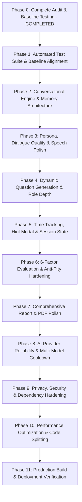

# IMPLEMENTATION_ROADMAP.md — Phased Implementation Plan & Milestones

**Document Date:** November 2026  
**Status:** PROPOSED — AWAITING USER APPROVAL PRIOR TO IMPLEMENTATION

---

## 1. Overview of Execution Phases

Following the product development rules, source code modifications will not occur until this audit and roadmap are reviewed and approved. Once approved, implementation will proceed systematically in the designated phases.

---

## 2. Detailed Milestone Specifications

### Milestone 1: Test Suite Alignment & Baseline Fixes (Phase 1)
- **Scope:** 
  - Fix test suite imports (`fitz` / `PyPDF2` fallback in `test_resume_parser.py` and `test_end_to_end_workflow.py`).
  - Align `test_question_generator.py` and `test_unlimited_questions.py` to the verified dynamic question architecture.
  - Standardize `.env` path resolution across all test files.
- **Verification Gate:** All existing backend test scripts pass (`OK`).

### Milestone 2: Conversational Engine & Memory Architecture (Phase 2 & 3)
- **Scope:**
  - Enhance `conversation_manager.py` with multi-turn bounded context memory: track technologies mentioned, architectural claims, and candidate design decisions across turns.
  - Implement dynamic follow-up decision engine: clarification vs. technical deep-dive vs. failure recovery vs. graceful topic bridge.
  - Replace rigid word-count threshold with concept-grounded semantic completeness.
- **Verification Gate:** Run 40 conversational scenario tests verifying context retention and absence of robotic clichés.

### Milestone 3: Dynamic Question Generation & Role Specialization (Phase 4 & 5)
- **Scope:**
  - Fix AI parsing in `question_generator.py` to prevent `'str' object has no attribute 'get'` fallback.
  - Verify and expand all 9 domain profiles (Software, Backend, Frontend, Full Stack, Data, Fabric, DevOps, Cloud Architect, AI/ML).
  - Ensure timer precision using monotonic timestamps to prevent browser backgrounding drift.
- **Verification Gate:** Test dynamic question generation across all 9 profiles with verified role depth.

### Milestone 4: Evaluation, Report & Hint System (Phase 6 & 7)
- **Scope:**
  - Verify mathematical accuracy of the 6-factor weighted rubric.
  - Ensure zero points for non-substantive text while fairly evaluating concise correct technical answers.
  - Refine `report_generator.py` prompt token limits to prevent Groq `json_validate_failed` on long outputs.
  - Clean legacy branding (`Nitya UI`) from `InterviewReport.jsx`.
- **Verification Gate:** End-to-end report generation verified for both 1-question speed sessions and full multi-turn interviews.

### Milestone 5: Privacy, Security, Performance & Production Readiness (Phase 8 - 11)
- **Scope:**
  - Add in-memory session TTL eviction (prune sessions $> 2$ hours old) to prevent memory leaks on free cloud tiers.
  - Add in-memory sliding-window rate limiting on `/api/interview/*` endpoints.
  - Update vulnerable dependencies in `frontend/package.json` (`axios`, `react-router-dom`).
  - Code-split frontend bundles using `React.lazy()` for sub-200kB initial page loads.
  - Prepare production deployment guide (`PRODUCTION_DEPLOYMENT_GUIDE.md`) and deployment checklist.
- **Verification Gate:** Production build succeeds, security audit is clean, and live deployment verification passes.

---

## 3. Stop Point for User Approval

> [!IMPORTANT]
> **Phase 0 Discovery is Complete.**
> As instructed by the development rules, the agent will **STOP here** and present the comprehensive audit findings and roadmap to the user. Implementation will begin immediately upon user confirmation.
