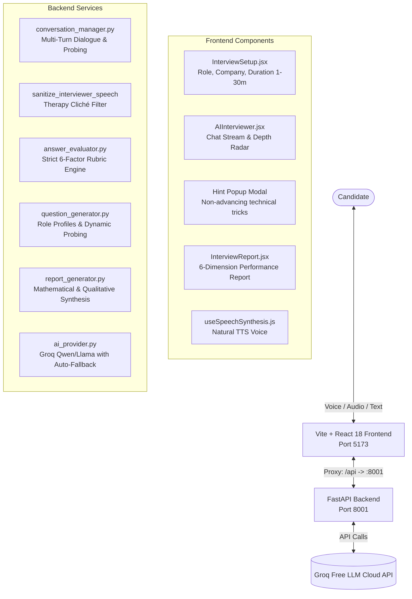
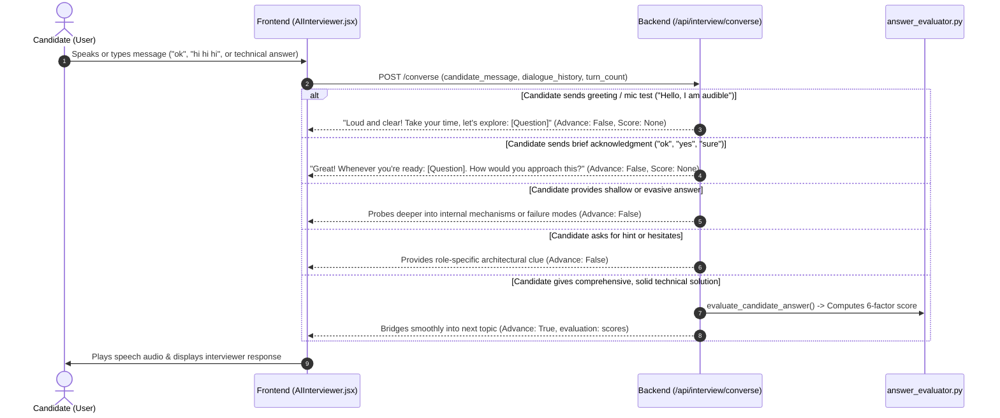

# AI Interview Coach 1.0 — Architecture & System Workflow Report

**Document Date:** November 2026  
**Project:** AI Interview Coach (Conversational Technical Hiring Platform)  
**Version:** 1.0 (Production-Ready Architecture)

---

## 1. Executive Summary

**AI Interview Coach** is an intelligent, multi-turn technical interview simulator that emulates a real-world **Senior/Staff Engineer and Technical Hiring Lead**. 

Unlike conventional mock interview tools that act as rigid question-and-answer quizzes with static topic counters, this platform delivers an **organic, human-to-human technical conversation**:
- **Continuous Back-and-Forth Dialogue:** The interviewer actively listens to candidate replies, validates technical choices (e.g., Redis, Kafka, B-Trees, ACID transactions), and probes deeper into architectural trade-offs, concurrency, and scale bottlenecks.
- **Custom Time Limits (No Arbitrary Question Limits):** Candidates choose their session duration (**1 min, 5 min, 10 min, 20 min, or 30 min**). The interview continues dynamically for as many questions as time allows.
- **Intelligent Tone & Persona:** Zero robotic therapy clichés (banned phrases like *"No problem!"*, *"Let's take a breath"*, or scripted templates). The interviewer interacts as a sharp, collegiate engineering colleague.
- **Strict Anti-Pity Evaluation Engine:** Gibberish, mic tests, or evasions (such as `"hi hi hi"`, `"ok"`, or `"Hello, I am audible"`) are strictly scored **0.0 / 100**, eliminating accidental participation points.
- **Dedicated Non-Advancing Hint Modal:** Clicking the hint button displays structured technical clues in a clean modal popup without skipping questions or advancing the interview.
- **Real-Time Speech Synthesis:** Every interviewer response and the "time is up" notification is spoken aloud using natural browser speech synthesis.

---

## 2. High-Level System Architecture



---

## 3. Core Component Workflows

### 3.1. Session Setup & Configuration (`InterviewSetup.jsx`)
Candidates configure their target interview scenario:
- **Target Company:** Google, Meta, Amazon, Microsoft, Netflix, or Custom.
- **Target Role:** Software Engineer, Data Engineer, Frontend Developer, Backend Developer, Full Stack Developer, DevOps Engineer, Fabric Engineer, Cloud Architect, AI Engineer.
- **Difficulty Level:** Entry-Level, Intermediate, Senior / Staff, Principal.
- **Interview Focus:** Technical Coding & Systems, System Design, Behavioral, Full Comprehensive.
- **Custom Duration Selector:** Quick **1 min** (speed practice), **5 min**, **10 min**, **20 min**, or **30 min** (full session).
- **Resume & Job Description Integration:** Optional PDF/DOCX resume upload extracts personalized project highlights.

---

### 3.2. Live Conversational Interview Flow (`conversation_manager.py`)

Rather than treating candidate replies as isolated answers, the conversational manager maintains a live dialogue history.



#### Key Conversational Features:
1. **Context-Aware Dialogue:** The AI references the exact technologies, tools, and algorithms the candidate mentions (e.g., Redis, Kafka, connection pooling, composite indexing).
2. **Deep Technical Probing:** Explores real-world engineering concerns:
   - *Scale Focus:* What happens under a 20x traffic spike?
   - *Failure Modes:* How does the system recover if a primary node crashes during write operations?
   - *Internals:* Why choose B-Tree over LSM-Tree? How are race conditions mitigated?
3. **No Premature Question Jumping:** The AI remains on the current topic until the candidate provides technical depth. Short responses ($< 12$ words) will never trigger an automatic question advance.

---

### 3.3. Anti-Therapy Speech Sanitizer (`sanitize_interviewer_speech`)

To ensure the AI maintains a credible Senior Engineering persona, an automated speech filter intercepts every output before transmission:
- **Filtered Patterns:** Strips canned therapy phrases:
  - `No problem` / `No problem at all` / `No worries`
  - `Take a deep breath` / `Let's take a breath`
  - `Let's think through this together`
  - `Don't worry at all` / `It's completely fine`
- **Output:** Professional, direct peer-to-peer engineering dialogue.

---

### 3.4. On-Demand Hint Modal (`POST /api/interview/hint`)

- Clicking the **"Interviewer Clue"** button in the top action bar opens a non-intrusive popup modal.
- Calls `/api/interview/hint` with the current question context.
- Returns a structured hint tailored to the specific role without advancing or skipping the question.
- The candidate reviews the tip at their own pace, clicks **"Got It, Continue Answering"**, and resumes typing or speaking their answer.

---

### 3.5. Dynamic Time Concluded Modal

When the selected interview duration elapses (1m to 30m):
- A natural voice announcement sounds: *"Your scheduled interview time has concluded."*
- A specialized **Time Concluded** modal appears:
  - **If 0 questions were completed:** Offers **"Keep Discussing"** or **"Leave Interview"** (preventing premature empty report errors).
  - **If $\ge 1$ question was completed:** Offers **"Keep Discussing"** or **"View Comprehensive Report"**.

---

## 4. Scoring Engine & Rubric (`answer_evaluator.py`)

Candidate answers are evaluated against a **strict 6-dimension weighted rubric (100 points total)**:

| Dimension | Weight | Criteria |
| :--- | :---: | :--- |
| **Technical Correctness** | **25%** | Conceptual accuracy, architectural validity, correct algorithm/protocol choices. |
| **Relevance** | **20%** | Directly addresses what was asked without dodging, filler, or fluff. |
| **Communication Clarity** | **15%** | Clear reasoning, logical explanations, and proper engineering terminology. |
| **Problem Solving** | **15%** | Analytical thinking, handling trade-offs, consideration of edge cases. |
| **Practical Examples** | **15%** | Concrete implementation details, real-world tools, past project context. |
| **Answer Structure** | **10%** | Systematic flow: Context $\to$ Approach $\to$ Trade-offs $\to$ Production Verification. |

### Anti-Pity / Non-Substantive Clamping Mechanism
- **Non-Substantive Detection (`is_non_substantive_response`):** Automatically catches repeated phrases (`"hi hi hi"`, `"test test test"`), single-word affirmations (`"ok"`, `"yes"`), mic tests (`"am I audible"`), or evasions (`"i don't know"`).
- **Strict 0.0 Points:** All 6 dimensions receive **0.0 / 100**.
- **Automatic Zero Clamp:** If an answer receives Technical Correctness $\le 2.0$ or Relevance $\le 2.0$, all other categories are clamped to **0.0**. Pity points are eliminated.

---

## 5. Comprehensive Feedback Report (`report_generator.py`)

The final report provides an exhaustive, multi-tier evaluation:
1. **Mathematical Aggregate Scores:** Total overall performance and breakdown across all 6 dimensions.
2. **Question-by-Question Deep Dive:**
   - Candidate's actual transcript.
   - What was correct (grounded strengths).
   - What was missing (critical architectural gaps).
   - Expert model answer.
   - Actionable one-sentence advice.
3. **Qualitative Findings:**
   - Identified technical gaps and repeated patterns.
   - Readiness estimate (*"Interview Ready"*, *"Developing"*, *"Needs Foundational Preparation"*).
   - Tailored learning curriculum.
   - **5 Custom Follow-Up Practice Questions** specifically generated to address discovered weak points.

---

## 6. Supported Engineering Specializations

The generator incorporates dedicated domain profiles with specific architectural pillars, failure modes, and scale focuses:

1. **Software Engineer:** Concurrency, distributed locks, database indexing, race conditions, connection pool exhaustion.
2. **Backend Developer:** High-throughput APIs, asynchronous message queues (Kafka/RabbitMQ), B-Trees vs LSM-Trees, database deadlocks, circuit breakers.
3. **Frontend Developer:** React virtual DOM reconciliation, Core Web Vitals (LCP, INP, CLS), client-side cache invalidation, layout thrashing, state management.
4. **Full Stack Developer:** End-to-end data flow, optimistic UI updates vs server consistency, schema migrations, REST/gRPC contracts.
5. **Data Engineer:** Distributed PySpark DAG optimization, partition skew, Delta Lake/Iceberg ACID guarantees, Kafka CDC ingestion.
6. **Fabric Engineer:** Microsoft Fabric OneLake, Medallion Architecture (Bronze/Silver/Gold), Direct Lake mode, PySpark V-Order compaction, Lakehouse vs Warehouse.
7. **DevOps / SRE:** Kubernetes scheduling, pod disruption budgets, CI/CD canary rollouts, Terraform state drift, OpenTelemetry distributed tracing.
8. **Cloud Solutions Architect:** Multi-region active-active failover, RPO/RTO, hub-and-spoke VPC networks, private endpoints, cloud cost optimization.
9. **AI / ML Engineer:** RAG chunking strategies, vector embeddings (HNSW), LLM latency/quantization, hallucination guardrails, LoRA fine-tuning.

---

## 7. Local Run & Deployment Guide

### Port Allocations
- **Frontend:** `http://localhost:5173` (Vite React Dev Server)
- **Backend:** `http://localhost:8001` (FastAPI Uvicorn with auto-reload)
- *Note:* Vite automatically proxies `/api/*` requests from `5173` to `8001`, eliminating CORS issues.

### Running Backend
```powershell
cd AI-Interview-feature\backend
python -m uvicorn app.main:app --host 127.0.0.1 --port 8001 --reload
```

### Running Frontend
```powershell
cd AI-Interview-feature\frontend
npx vite --port 5173 --strictPort
```

### Environment Configuration (`backend/.env`)
```env
# Primary Free LLM Provider (Groq Cloud)
GROQ_API_KEY=your_groq_api_key_here
GROQ_MODEL=qwen/qwen3.8-27b

# Server Port
PORT=8001
HOST=127.0.0.1
```
*(The system features automatic multi-model failover if a specific model encounters rate limits).*
